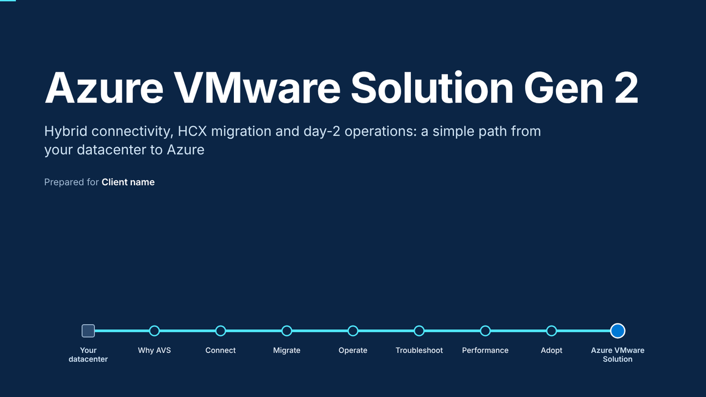
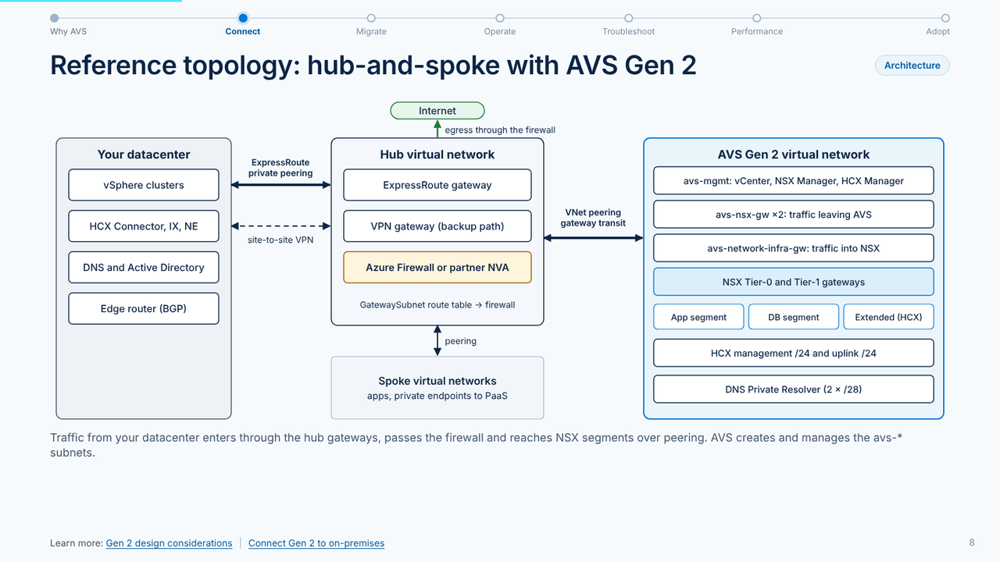
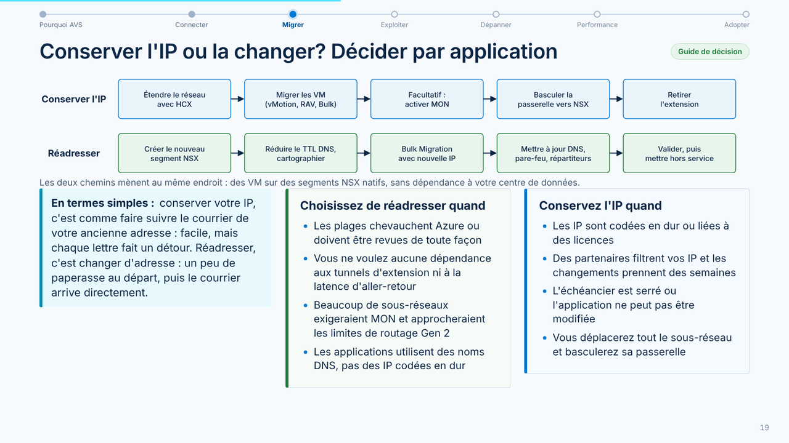
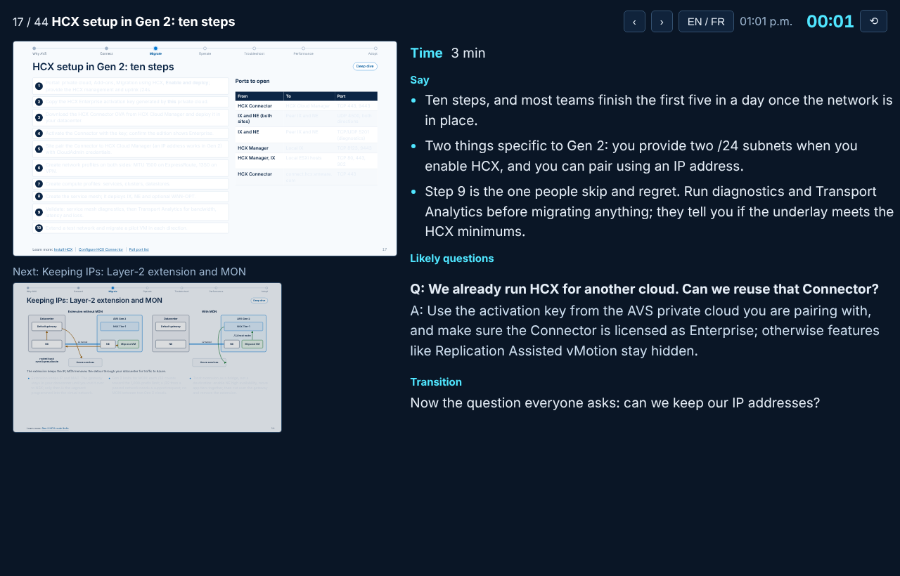
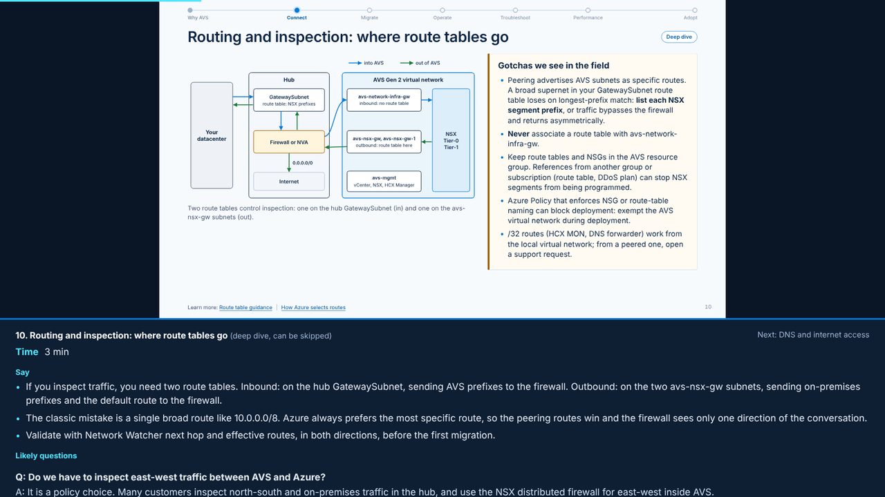

# Azure VMware Solution Gen 2: bilingual client deck

A ready-to-present slide deck for client meetings about **Azure VMware Solution (AVS) Gen 2**. It covers hybrid connectivity from on-premises VMware, migration with VMware HCX (including re-IP), day-2 operations, troubleshooting, and performance and benchmarking.

The deck is one self-contained HTML file. It looks and behaves like a slide deck, switches between English and French, and has a hidden talk track for the presenter.



## White label

This is a **white-label deck**. It carries no company branding, logos, partner names or client names, so any consultant, partner or internal team can present it as their own.

- Put the client name, presenter name and meeting date in the `DECK_CONFIG` block at the top of the HTML file. They appear on the title slide.
- The "How we help" panel on the *Next steps* slide is generic. Adjust it to describe your own services.
- The colour palette is Azure-inspired but uses no Microsoft logos or trademarks as artwork. Product names (Azure, VMware, HCX, NSX, vSAN, ExpressRoute and others) belong to their owners. This project is not affiliated with or endorsed by Microsoft or Broadcom.

## Features

- **One HTML file, works offline.** It has no external fonts, scripts or images, so you can present without internet access.
- **16:9 slides that scale to any screen.** Navigate with the keyboard, the on-screen toolbar or a swipe. A slide counter, a progress bar and a "route line" across the top show where you are in the agenda.
- **English and French toggle (fr-CA).** Everything switches: slide text, diagram labels and the talk track. The choice is remembered between sessions.
- **Hidden talk track on every slide.** For each slide it gives what to say, timing, likely client questions with suggested answers, and the transition to the next slide. It is hidden by default; show it under the slide, or open it in a separate presenter window.
- **Presenter window.** A separate window shows the notes, previews of the current and next slides, a clock and an elapsed timer. It stays in sync with the main deck, so you can screen-share only the slides.
- **Three layers per topic.**
  - *Executive summary*: business value, risk and cost.
  - *ELI5*: a plain-language explanation with an everyday analogy.
  - *Deep dive*: architecture, configuration, limits and gotchas.
- **Deep-dive skip mode.** One key hides the technical deep dives for an executive audience. They are still in the file and still print.
- **Hand-drawn inline SVG diagrams.** Reference topology, routing and inspection, DNS flow, HCX architecture, migration-type decision tree, Layer-2 extension with and without MON, keep-IP vs re-IP paths, wave timeline, hop-by-hop troubleshooting, migration throughput ceilings, and the adoption roadmap.
- **Reference links on every topic.** They point to Microsoft Learn, Microsoft Tech Community and Broadcom documentation, with a full reference slide at the end.
- **Print to PDF** from the browser, one slide per page.

## What the deck covers

44 slides, about 90 minutes, Gen 2 only. Gen 2 private clouds are deployed inside an Azure virtual network; the older generation's networking is not covered.

| Section | Minutes | Highlights |
| --- | --- | --- |
| Why AVS | 8 | Value, licensing (portable VCF), Gen 2 in one picture, shared responsibility |
| Connect | 17 | Hub-and-spoke reference topology, IP plan (/22 plus two /24s for HCX), route tables and inspection, DNS and internet, ExpressRoute vs VPN sizing |
| Migrate | 25 | HCX architecture and ports, choosing a migration type, ten-step setup, Layer-2 extension and MON, **re-IP decision and runbook**, wave planning, AVS vs native Azure VMs |
| Operate | 10 | Ten most common operational tasks, monitoring baseline, operating rhythm |
| Troubleshoot | 15 | Hop-by-hop method, top HCX issues, top Gen 2 network and platform issues, command toolkit |
| Performance | 10 | AV64 sizing, fair benchmark method, migration throughput math, tuning tips |
| Adopt | 5 | Phased roadmap, next steps and decisions |
| Appendix | — | FAQ, re-IP script examples (Windows and Linux), references |





## How to use it

### 1. Download and personalize

1. Download [`avs-gen2-client-deck.html`](avs-gen2-client-deck.html).
2. Open it in a text editor and edit the config block near the top:

   ```html
   window.DECK_CONFIG = { client: "Client name", presenter: "", date: "" };
   ```

3. Save, then open the file in a current browser. Microsoft Edge and Google Chrome are recommended.

### 2. Present

| Key | Action |
| --- | --- |
| `→` `Space` `PageDown` | Next slide |
| `←` `PageUp` | Previous slide |
| `Home` / `End` | First / last slide |
| `L` | Switch English / French |
| `N` | Show or hide the talk track under the slide |
| `P` | Open the presenter window |
| `D` | Skip or include deep-dive slides |
| `O` | Slide list (click a title to jump) |
| `F` | Full screen |
| `Esc` | Close the slide list |

The same controls are on the toolbar in the bottom-right corner. It fades out after a few seconds without mouse movement. You can also link straight to a slide by adding `#12` to the URL.

**When screen sharing:** press `P` to open the presenter window and keep it on your own screen. Share only the deck window or tab, which never shows the notes. If the presenter window does not open, allow pop-ups for the file.





### 3. Export to PDF

Press `Ctrl+P` (`Cmd+P` on a Mac) and choose **Save as PDF**. Set margins to *None* and turn on *Background graphics*. Each slide prints on its own 16:9 page in the language currently selected.

## Editing the content

The HTML file is generated from Python sources in [`src/`](src). Every visible string is written as an English and French pair, so both languages stay in sync.

| File | Contents |
| --- | --- |
| `src/lib.py` | Helpers for bilingual text, tables, panels, talk-track notes and SVG diagrams |
| `src/s_intro.py` | Title, agenda, why AVS, Gen 2 overview, shared responsibility |
| `src/s_connect.py` | Connectivity section |
| `src/s_migrate.py` | Migration and re-IP section |
| `src/s_ops.py` | Operations and troubleshooting sections |
| `src/s_perf.py` | Performance, adoption roadmap and appendix |
| `src/build.py` | Styles, deck behaviour, and assembly into one HTML file |

To rebuild after an edit (a recent Python 3, no extra packages):

```bash
python3 src/build.py            # writes avs-gen2-client-deck.html at the repo root
```

You can also edit the HTML directly. Each piece of text appears twice, in an element with class `l-en` and one with class `l-fr`.

### Optional quality checks

The scripts in [`tools/`](tools) use Playwright and Chromium. `check.py` renders every slide in both languages, saves screenshots to `shots/`, and reports text that overflows a slide or a diagram box. `functest.py` exercises the toggles, the presenter window and PDF printing.

```bash
pip install playwright && python3 -m playwright install chromium
python3 tools/check.py
python3 tools/functest.py
```

## Accuracy and currency

Facts, limits and links were checked against Microsoft Learn and Broadcom documentation in **October 2026**. Notable points the deck states openly:

- New AVS capacity requires a portable VMware Cloud Foundation subscription purchased from Broadcom.
- Microsoft documents slower Bulk and Replication Assisted vMotion sync phases on Gen 2 today.
- Zerto is not available on Gen 2.

Gen 2 is evolving quickly. Recheck regions, limits and supported integrations before each engagement, and treat the roadmap timeline as illustrative.
